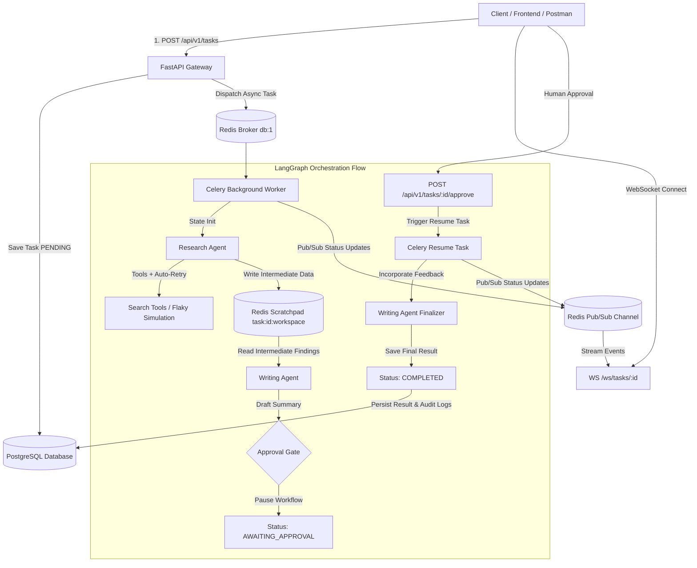

# Collaborative AI Agent Orchestration Framework with LangGraph

[](https://www.python.org/)
[](https://fastapi.tiangolo.com/)
[](https://github.com/langchain-ai/langgraph)
[](https://docs.celeryq.dev/)
[](https://redis.io/)
[](https://www.postgresql.org/)
[](https://www.docker.com/)

A production-grade, asynchronous multi-agent orchestration ecosystem where specialized AI agents collaborate across multi-step workflows. Built with **LangGraph**, **FastAPI**, **Celery**, **Redis**, and **PostgreSQL**, featuring persistent checkpointing, ephemeral workspace scratchpads, real-time WebSocket streaming, and Human-in-the-Loop (HITL) pause/resume gates.

---

## 🏛️ System Architecture



---

## ✨ Key Features

1. **Stateful Graph Orchestration (LangGraph)**:
   - Modular separation of concerns between specialized agents (`ResearchAgent` and `WritingAgent`).
   - Centralized typed state (`AgentWorkflowState`) with strict transition controls.

2. **Dual-Tier State Management**:
   - **PostgreSQL (`tasks` table)**: High-level persistent task metadata, execution status, and audit logs.
   - **Redis Shared Scratchpad (`task:<task_id>:workspace`)**: Ephemeral, ultra-fast inter-agent data exchange avoiding database bloat.

3. **Asynchronous Background Processing (Celery + Redis)**:
   - HTTP requests return in `< 500ms` with `202 Accepted` and a unique task UUID.
   - Decoupled workers execute long-running LLM workflows without blocking the web gateway.

4. **Human-in-the-Loop (HITL) Gating**:
   - The workflow executes Phase 1 (research + initial draft), safely transitions to `AWAITING_APPROVAL`, and pauses execution.
   - External approval via `POST /api/v1/tasks/{task_id}/approve` injects human feedback and triggers Phase 2 to completion.

5. **Real-Time WebSocket Streaming (`/ws/tasks/{task_id}`)**:
   - Live status broadcast (`RUNNING`, `AWAITING_APPROVAL`, `RESUMED`, `COMPLETED`) via Redis Pub/Sub directly to connected clients.

6. **Self-Healing Fault Tolerance & Automatic Retry**:
   - Resilient retry handlers for transient network timeouts on flaky tools (e.g. `__FLAKY_TEST__` query simulation).

7. **Structured Machine-Readable JSON Observability**:
   - Every action, step, failure, and retry is written as a JSON line to `logs/agent_activity.log`:
     ```json
     {"timestamp": "2026-09-29T10:00:05.123Z", "task_id": "...", "agent_name": "ResearchAgent", "action_details": "Starting web search for 'LangGraph features'"}
     ```

8. **Audit Trail Tracking (`agent_logs`)**:
   - The database stores a chronological JSON array of all agent interventions for enterprise auditability.

---

## 📁 Repository Structure

```
.
├── docker-compose.yml       # Production container orchestration (api, worker, db, redis)
├── Dockerfile               # Production image definition for Python services
├── .env.example             # Complete environment variable template
├── .env                     # Local environment configuration
├── requirements.txt         # Production and testing Python dependencies
├── README.md                # System documentation and operational manual
├── logs/
│   └── agent_activity.log   # Structured JSON audit log stream
├── src/
│   ├── main.py              # FastAPI application entrypoint and lifespan hooks
│   ├── api/
│   │   ├── routes.py        # REST API endpoints (tasks CRUD, approval)
│   │   └── websocket.py     # Real-time WebSocket task status streamer
│   ├── worker/
│   │   ├── celery_app.py    # Celery configuration and worker initialization
│   │   └── tasks.py         # Celery background tasks (Phase 1 & Phase 2 execution)
│   ├── agents/
│   │   ├── state.py         # LangGraph TypedDict state definition
│   │   ├── tools.py         # Simulated search tool, flaky tool, and retry engine
│   │   ├── research_agent.py# Information gathering node & Redis scratchpad writer
│   │   ├── writing_agent.py # Synthesis node & human feedback refiner
│   │   ├── workflow.py      # Compiled LangGraph StateGraph & conditional edges
│   │   └── llm_factory.py   # Multi-provider LLM factory (OpenAI/Anthropic/Gemini)
│   ├── db/
│   │   ├── models.py        # SQLAlchemy Task model (UUID, JSONB, Timestamps)
│   │   ├── session.py       # Async & Sync engine/session makers and auto-migrations
│   │   └── schemas.py       # Pydantic request/response validation schemas
│   ├── services/
│   │   ├── redis_service.py # Redis scratchpad operations and Pub/Sub broker
│   │   └── task_service.py  # Async and Sync task database service
│   └── config/
│       ├── settings.py      # Pydantic Settings management
│       └── logging_config.py# Structured JSON logging formatter and handlers
└── tests/
    ├── conftest.py          # Pytest fixtures, test DB, and mock Redis
    ├── test_api.py          # REST endpoint tests
    ├── test_db.py           # Database schema & CRUD tests
    ├── test_redis_scratchpad.py # Scratchpad inter-agent data tests
    ├── test_agents.py       # Unit tests for agent nodes and synthesizers
    ├── test_retry_flaky.py  # Flaky tool simulation & retry logging tests
    ├── test_websocket.py    # WebSocket status streaming tests
    └── test_workflow.py     # End-to-end multi-agent LangGraph workflow tests
```

---

## 🚀 Quick Start Guide

### 1. Prerequisites
- [Docker & Docker Compose](https://docs.docker.com/get-docker/) installed.
- (Optional for local development) Python 3.11+

### 2. Configure Environment
Copy `.env.example` to `.env`:
```bash
cp .env.example .env
```

### 3. Launch with Docker Compose
Start all 4 services (`db`, `redis`, `api`, `worker`) in one command:
```bash
docker-compose up --build
```

All services will perform self-healing healthchecks:
- **`db`**: PostgreSQL initialized on port `5432` with healthcheck (`pg_isready`).
- **`redis`**: Redis initialized on port `6379` with healthcheck (`redis-cli ping`).
- **`api`**: FastAPI server running on `http://localhost:8000` with healthcheck (`curl http://localhost:8000/health`).
- **`worker`**: Celery worker listening for background agent execution tasks.

---

## 📡 API Reference & Verification Workflow

### 1. Initiate a Collaborative Agent Task
**Endpoint**: `POST /api/v1/tasks` (Returns `202 Accepted` in `< 500ms`)

```bash
curl -X POST http://localhost:8000/api/v1/tasks \
  -H "Content-Type: application/json" \
  -d '{"prompt": "Research the key features of LangGraph and CrewAI. Write a short comparison summary for a technical audience."}'
```

**Response (202 Accepted)**:
```json
{
  "task_id": "7f8b9c2a-4d3e-4b5a-9a1b-3c4d5e6f7a8b",
  "status": "PENDING"
}
```

---

### 2. Stream Live Updates over WebSocket
**Endpoint**: `WS /ws/tasks/{task_id}`

Connect with any WebSocket client (`wscat -c ws://localhost:8000/ws/tasks/{task_id}`):
```json
{"task_id": "7f8b9c2a-4d3e-4b5a-9a1b-3c4d5e6f7a8b", "status": "RUNNING"}
{"task_id": "7f8b9c2a-4d3e-4b5a-9a1b-3c4d5e6f7a8b", "status": "AWAITING_APPROVAL"}
```

---

### 3. Poll Task Status and Intermediate State
**Endpoint**: `GET /api/v1/tasks/{task_id}`

```bash
curl http://localhost:8000/api/v1/tasks/7f8b9c2a-4d3e-4b5a-9a1b-3c4d5e6f7a8b
```

**Response (200 OK - Paused for Human Approval)**:
```json
{
  "id": "7f8b9c2a-4d3e-4b5a-9a1b-3c4d5e6f7a8b",
  "prompt": "Research the key features of LangGraph and CrewAI. Write a short comparison summary for a technical audience.",
  "status": "AWAITING_APPROVAL",
  "result": null,
  "agent_logs": [
    {
      "agent": "ResearchAgent",
      "action": "Searching for Research the key features of LangGraph and CrewAI features",
      "timestamp": "2026-09-29T10:00:05Z"
    },
    {
      "agent": "WritingAgent",
      "action": "Drafting comparison summary",
      "timestamp": "2026-09-29T10:00:15Z"
    }
  ],
  "created_at": "2026-09-29T10:00:00Z",
  "updated_at": "2026-09-29T10:00:15Z"
}
```

---

### 4. Provide Human Approval to Resume Workflow
**Endpoint**: `POST /api/v1/tasks/{task_id}/approve`

```bash
curl -X POST http://localhost:8000/api/v1/tasks/7f8b9c2a-4d3e-4b5a-9a1b-3c4d5e6f7a8b/approve \
  -H "Content-Type: application/json" \
  -d '{"approved": true, "feedback": "Emphasize enterprise reliability and fault tolerance."}'
```

**Response (200 OK)**:
```json
{
  "task_id": "7f8b9c2a-4d3e-4b5a-9a1b-3c4d5e6f7a8b",
  "status": "RESUMED"
}
```

---

### 5. Retrieve Completed Final Result
**Endpoint**: `GET /api/v1/tasks/{task_id}`

```bash
curl http://localhost:8000/api/v1/tasks/7f8b9c2a-4d3e-4b5a-9a1b-3c4d5e6f7a8b
```

**Response (200 OK - COMPLETED)**:
```json
{
  "id": "7f8b9c2a-4d3e-4b5a-9a1b-3c4d5e6f7a8b",
  "prompt": "Research the key features of LangGraph and CrewAI. Write a short comparison summary for a technical audience.",
  "status": "COMPLETED",
  "result": "# Technical Comparison: LangGraph vs. CrewAI\n\n## Executive Summary...",
  "agent_logs": [
    {
      "agent": "ResearchAgent",
      "action": "Searching for Research the key features of LangGraph and CrewAI features",
      "timestamp": "2026-09-29T10:00:05Z"
    },
    {
      "agent": "WritingAgent",
      "action": "Drafting comparison summary",
      "timestamp": "2026-09-29T10:00:15Z"
    },
    {
      "agent": "WritingAgent",
      "action": "Finalizing comparison summary following approval",
      "timestamp": "2026-09-29T10:00:25Z"
    }
  ],
  "created_at": "2026-09-29T10:00:00Z",
  "updated_at": "2026-09-29T10:00:25Z"
}
```

---

## 🔍 Redis Scratchpad Inspection

While the task is running or paused in `AWAITING_APPROVAL`, inspect the Redis container:
```bash
docker exec -it agent_redis redis-cli get task:7f8b9c2a-4d3e-4b5a-9a1b-3c4d5e6f7a8b:workspace
```

---

## 🛡️ Fault Tolerance & Flaky Tool Test

Test self-healing retries by submitting a prompt containing `__FLAKY_TEST__`:
```bash
curl -X POST http://localhost:8000/api/v1/tasks \
  -H "Content-Type: application/json" \
  -d '{"prompt": "__FLAKY_TEST__"}'
```

Inspect `logs/agent_activity.log`:
```bash
tail -n 10 logs/agent_activity.log
```
The log will reflect:
1. `Starting web search for '__FLAKY_TEST__'`
2. `Tool failure encountered: Simulated transient network timeout. Initiating retry...`
3. `Retry attempt 1 for action: web search '__FLAKY_TEST__'`
4. `Successfully completed web search for '__FLAKY_TEST__'`

---

## 🧪 Running Automated Tests

Run the complete test suite locally:
```bash
pytest -v
```

All 18 tests cover:
- ✅ REST API endpoints & latency constraints (<500ms)
- ✅ Database schema integrity & JSON audit log persistence
- ✅ Redis scratchpad workspace key pattern & inter-agent passing
- ✅ Flaky tool transient failure simulation & automatic retry
- ✅ Structured JSON log formatting and file persistence
- ✅ Full two-phase LangGraph orchestration with human approval gate
- ✅ Real-time WebSocket event streaming
